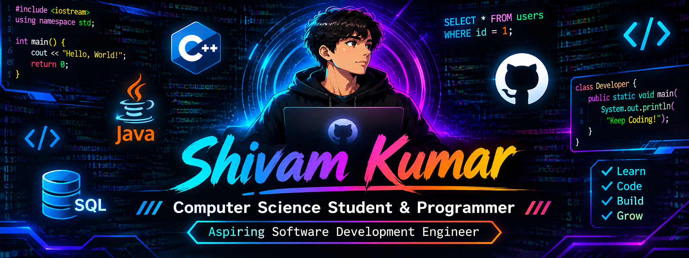

# Hi, I'm Shivam Kumar

### Computer Science Student | Aspiring Software Developer

B.Tech CSE Core student at **Galgotias University** · Expected graduation: **2029**

## 🌐 Connect With Me

  
  
  
  
  

---

## About Me

I'm a B.Tech Computer Science and Engineering student passionate about programming, software development, and learning new technologies. I'm working toward becoming a Software Development Engineer and building practical, real-world projects.

- Studying **Computer Science and Engineering (CSE Core)** at Galgotias University.
- Interested in **Software Development, Data Structures & Algorithms, and Java Development**.
- Building my skills through coursework, problem-solving, and personal projects.

## Currently Learning

- Advanced Data Structures & Algorithms
- Java Development
- SQL and Database Management Systems

## Technical Skills

**Programming languages**

**Frontend**

**Backend and databases**

**Developer tools**

**Core concepts**

- Data Structures & Algorithms
- Object-Oriented Programming
- Problem Solving

## Featured Project

### [Travel & Tourism Management System](https://github.com/ShivamKumar280/TravelTourismManagementSystem)

A Java-based travel booking management system with customer and admin functionality.

**Technologies:** Java · Java Swing · MySQL · JDBC · Maven · HTML · CSS · JavaScript

**Project features**
- User authentication
- Travel packages
- Hotel management
- Destination management
- Booking management
- E-tickets
- Admin dashboard

**My contribution:** Designed and developed the project, including frontend, backend, and database integration.

**Status:** In progress

## GitHub Statistics

  
  
   
  

## Education

**Galgotias University**

- Bachelor of Technology (B.Tech)
- Computer Science and Engineering — Core
- Expected graduation: 2029

**Relevant coursework**
- Data Structures & Algorithms
- Object-Oriented Programming
- Database Management Systems
- Java Programming
- Computer Organization & Architecture
- Mathematics

## Connect

- **GitHub:** [ShivamKumar280](https://github.com/ShivamKumar280)
- **LeetCode:** [NenUser_08](https://leetcode.com/u/NenUser_08/)
- **GeeksforGeeks:** [shivam95e3](https://www.geeksforgeeks.org/profile/shivam95e3)
- **CodeChef:** [anonymousx08](https://www.codechef.com/users/anonymousx08)
- **Codolio:** [SHIVAM243](https://codolio.com/profile/SHIVAM243)

---

  Thanks for visiting my profile!

## || Shivam Submission Graph ||

  

